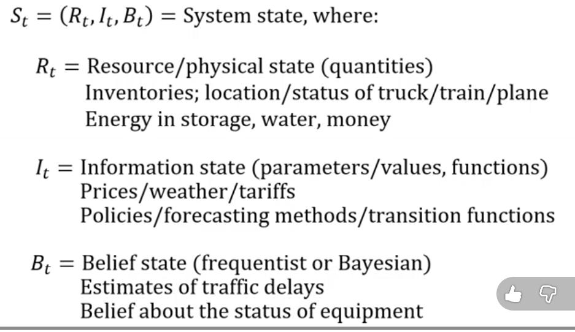
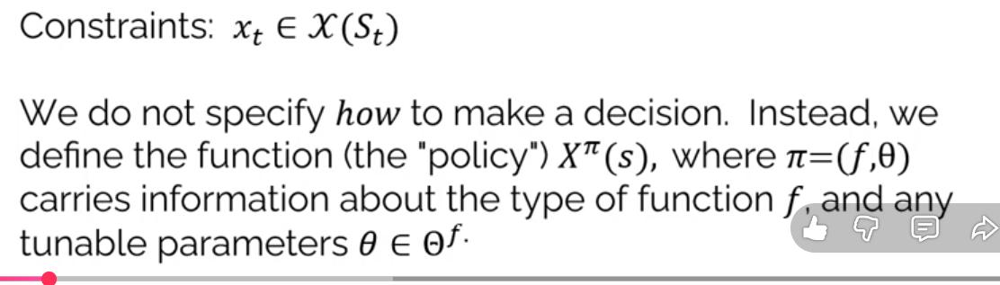
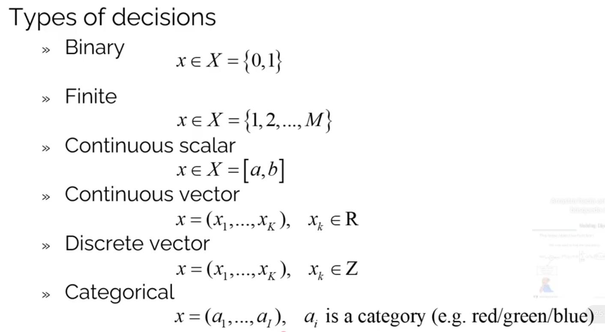
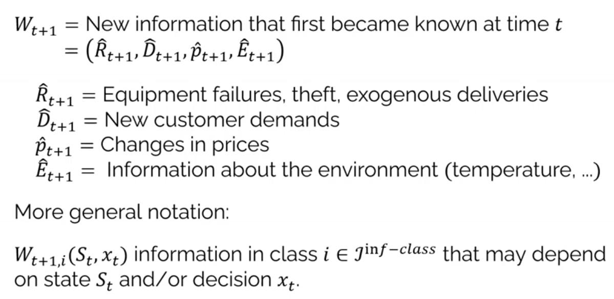

## Learning objectives

- Explain why classical modeling (linear programming, supervised ML) is insufficient for sequential decision problems.
- Define what a decision is and identify the three framing questions.
- Describe the five elements of the Universal Modeling Framework.
- Recognize the four classes of policies and give an example of each. *(pending)*

## Solving real-life problems {.small}

**To solve problems with computers we need to create a mathematical model**


## Solving real-life problems {.small}

**To solve problems with computers we need to create a mathematical model**


## Problem with classical modeling framework {.small}

Linear program / Supervised machine learning

- Assumes that all data is **known**
- Doesn't take into consideration that decisions are **repeatedly** taken **over time**
- Doesn't take into consideration the flow of **information**

## Problem with classical modeling framework {.small}

Linear program / Supervised machine learning

- Doesn't anticipate **external events** that can affect the performance of a decision
- Doesn't provide a way to **represent risk**
- Assumes a single decision-maker

## Types of decisions {.small}

A **decision** is information we control that **affects** the system.

1. Physical/financial
2. Discrete actions
3. Information acquisition/observation
4. Information communication/sharing
5. Choosing functions
6. Setting parameters
7. Estimation/identification

## Framing the problem {.small}

Before building a model, answer three questions:

1. What are the **performance metrics**?
   - Costs, revenues, profits, health outcomes, risk, ...

2. What **types of decisions** are being made (and who makes them)?
   - Physical/financial, discrete actions, information acquisition, ...
   - Single decision-maker or multiple agents?

3. What are the **uncertainties** that affect performance?
   - Initial beliefs (unknown parameters)
   - Exogenous information arriving over time

## Why we need prioritization {.small}

Even a **simple inventory problem** can be described with:

- **over 20** performance metrics
- **30** types of decisions
- **over 30** types of uncertainties

The full list is in Powell's [spreadsheet](https://tinyurl.com/PowellInventoryDecisions).

We cannot model all of this. We need to **prioritize**.


## Interaction matrix {.small}

How to prioritize: build a matrix of **metrics × decisions × uncertainties**.


[ASQ source](https://asq.org/quality-resources/house-of-quality)

*Analogy from quality engineering: the House of Quality.*

## Notations for modeling sequential decision problems {.small}

- **15** communities
- **8** notational styles

<br>


# Universal Modeling Framework

## General View {.small}

- Represents **any** aspect of a controllable system.
- Takes into consideration that the **system evolves** over time with new information.


More info: [video](https://www.youtube.com/watch?v=Vl5hipcYtyo), [article](https://warrenpowell.org/modeling-uncertainty/#categories)

## Using Continues Time {.small}

- The information arrives continuosly over time
- Functions, states, and decisions are measured at a point in time
- At time $t$ any variable indexed by:
   - $t' \leq t$ is **known**
   - $t' > t$ is **unknown**


## State Variables {.small}



## Decision $x_t$ {.small}




## Decision $x_t$ {.small}



## Exogenous Information [link]() {.small}

- We use `hat` to identify variables.



## Exogenous Information: Observational Uncertainty (1) {.small}

**Not knowing the true current state:**

- GPS/telematics places a truck several blocks from its actual position
- Warehouse system shows 40 units on hand, but the real count differs (mis-scans, misplaced pallets)
- Reefer container condition (e.g., inside temperature) can't be verified until opened

## Exogenous Information: Exogenous Uncertainty (2) {.small}

**External inputs we don't control:**

- Customer orders arrive in random volumes and at random times
- Truck breakdowns, or storms delaying vessels at a port
- Drivers calling in sick, causing sudden labor shortages

## Exogenous Information: Prognostic Uncertainty (3) {.small}

**Errors in forecasts:**

- Holiday-season demand forecast is off by 25%
- Predicted arrival of an ocean vessel is days off
- Forecasted fuel prices for next quarter miss actual prices

## Exogenous Information: Inferential Uncertainty (4) {.small}

**Errors in estimated parameters:**

- Estimating how a price change or faster delivery promise shifts demand
- Estimating true average transit time on a lane from limited shipment data
- Estimating remaining life of a truck component from sensor readings

## Exogenous Information: Experimental Variability (5) {.small}

**Noise in test results:**

- Pilot of a new delivery-route design gives different results week to week
- Warehouse layout simulation produces varying throughput across runs
- New packaging test shows different damage rates across trial shipments

## Exogenous Information: Model Uncertainty (6) {.small}

**Not knowing how the system works:**

- How do customers respond to a late delivery: cancel, reorder, or switch supplier?
- How does congestion at a distribution center build as volume grows?
- How do competitors' pricing and capacity changes affect our freight demand?

## Exogenous Information: Transitional Uncertainty (7) {.small}

**Random effects on how the system evolves:**

- Inventory shrinkage from theft, damage, or spoilage between periods
- Random loading/unloading times at docks change when vehicles become available
- Fluctuating traffic changes route time while a vehicle is en route

## Exogenous Information: Implementation Errors (8) {.small}

**Decisions not carried out as planned:**

- A driver ignores the recommended route (local knowledge) or skips a stop
- A picker pulls the wrong item or loads a pallet onto the wrong trailer
- A reefer unit fails, so the planned temperature isn't maintained

## Exogenous Information: Communication Errors (9) {.small}

**Instructions lost or misunderstood:**

- Dispatcher's verbal instruction is misheard, or an address is misread
- Language barriers with international partners cause wrong handling or customs paperwork
- A last-minute schedule change never reaches the receiving dock

## Exogenous Information: Algorithmic Instability (10) {.small}

**Different runs give different answers:**

- Vehicle routing solver returns different routes on the same data (random seeds, time limits)
- Heuristic load-planning software changes trailer assignments after a trivial change in input order
- Retraining an ML demand model on the same data gives noticeably different forecasts

## Exogenous Information: Goal Uncertainty (11) {.small}

**People disagree on the objective:**

- Finance wants lowest cost, sales wants fastest delivery, sustainability wants minimal emissions
- Planners differ on prioritizing on-time delivery vs. truck utilization
- Managers disagree on penalizing lateness vs. paying for expedited shipping

## Exogenous Information: Environmental Uncertainty (12) {.small}

**Broad conditions around the system:**

- New tariffs, trade restrictions, or customs rules change which lanes are viable
- Economic downturns or booms shift freight volumes and carrier capacity
- New regulations (hours-of-service, emissions standards) change what is allowed or profitable

# Modeling process

## Process Overview {.small}

```{mermaid}
flowchart LR
  A[Ambiguous Problem] --> B("Precise Definition <br> (Broken Down into Pieces)")
  B --> C[Computer Software]

  classDef nodeStyle fill:#1e293b,stroke:#38bdf8,stroke-width:2px,color:#f8fafc;
  classDef highlight fill:#0f172a,stroke:#60a5fa,stroke-width:2.5px,color:#ffffff;
  
  class A,C nodeStyle;
  class B highlight;
```


## The Narrative (step 1) {.small}

<br>

<br>

<br>

```{mermaid}
flowchart LR
    A["⚠️ Problem Definition<br/>Describe the problem in plain English"]
    B["📉 Consequences of Inaction<br/>What happens if the problem remains unsolved?"]
    D["🔍 Project Scope<br/>What will the solution address, and what is explicitly excluded?"]
    E["💡 Solution Overview<br/>Describe the solution to be developed and its main deliverables"]

    A --> B --> D --> E

    classDef danger fill:#2c0f14,stroke:#f87171,stroke-width:2px,color:#fef2f2,width:240px,white-space:normal,text-align:center;
    classDef warning fill:#2a1b0c,stroke:#fbbf24,stroke-width:2px,color:#fffbeb,width:240px,white-space:normal,text-align:center;
    classDef info fill:#0c2136,stroke:#38bdf8,stroke-width:2px,color:#f0f9ff,width:240px,white-space:normal,text-align:center;
    classDef success fill:#062319,stroke:#34d399,stroke-width:2px,color:#ecfdf5,width:240px,white-space:normal,text-align:center;

    class A danger;
    class B warning;
    class D info;
    class E success;
```


## Framing The Problem (step 2) {.small}

```{mermaid}

flowchart TD
    A["Step 2: Frame the Problem"]

    A --> B["1. Performance Metrics"]
    A --> C["2. Decision Structure"]
    A --> D["3. Sources of Uncertainty"]

    B --> B1["Define KPIs, units, baselines<br/>and target values"]
    B1 --> B2["Classify and prioritize metrics:<br/>objectives, targets and constraints"]

    C --> C1["Identify decision-makers,<br/>alternatives and constraints"]
    C1 --> C2["Determine when decisions occur,<br/>their frequency and available information"]
    C2 --> C3["Understand the process using<br/>appropriate industrial engineering tools"]

    C3 --> T{"What must be understood?"}
    T -->|Boundaries and interfaces| T1["SIPOC"]
    T -->|Operations and inspections| T2["Operations Process Chart"]
    T -->|Roles, handoffs and decisions| T3["Cross-Functional Flowchart"]
    T -->|Physical movement and distance| T4["Flow Diagram / String Diagram"]

    T1 --> E["Document the process<br/>and decision structure"]
    T2 --> E
    T3 --> E
    T4 --> E

    D --> D1["Identify uncertain inputs,<br/>events and outcomes"]
    D1 --> D2["Assess variability, frequency,<br/>magnitude, dependencies and extreme events"]
    D2 --> D3["Evaluate potential effects<br/>on performance metrics"]

    B2 --> F["Validate data availability,<br/>quality, granularity and measurement"]
    E --> F
    D3 --> F

    F --> G["Build a relationship matrix:<br/>metrics, decisions and uncertainties"]
    G --> H{"Is the problem sufficiently framed?"}

    H -->|No| I["Identify information gaps<br/>and collect additional evidence"]
    I --> B
    I --> C
    I --> D

    H -->|Yes| J["Framed Decision Problem"]
    J --> K["Prioritized performance metrics<br/>+ Decision structure<br/>+ Uncertainty sources<br/>+ Data limitations<br/>+ Testable impact hypotheses"]
```


# Modeling process

## Process Overview {.small}

```{mermaid}
flowchart LR
    A[Ambiguous Problem] --> B("Precise Definition<br/>(Broken Down into Pieces)")
    B --> C[Computer Software]

    classDef nodeStyle fill:#1e293b,stroke:#38bdf8,stroke-width:2px,color:#f8fafc;
    classDef highlight fill:#0f172a,stroke:#60a5fa,stroke-width:2.5px,color:#ffffff;
    class A,C nodeStyle;
    class B highlight;
```


## The Narrative (step 1) {.small}

<br>

<br>

<br>

```{mermaid}
flowchart LR
    A["⚠️ Problem Definition<br/>Describe the problem in plain English"]
    B["📉 Consequences of Inaction<br/>What happens if the problem remains unsolved?"]
    D["🔍 Project Scope<br/>What will the solution address, and what is explicitly excluded?"]
    E["💡 Solution Overview<br/>Describe the solution to be developed and its main deliverables"]

    A --> B --> D --> E

    classDef danger fill:#2c0f14,stroke:#f87171,stroke-width:2px,color:#fef2f2,width:240px,white-space:normal,text-align:center;
    classDef warning fill:#2a1b0c,stroke:#fbbf24,stroke-width:2px,color:#fffbeb,width:240px,white-space:normal,text-align:center;
    classDef info fill:#0c2136,stroke:#38bdf8,stroke-width:2px,color:#f0f9ff,width:240px,white-space:normal,text-align:center;
    classDef success fill:#062319,stroke:#34d399,stroke-width:2px,color:#ecfdf5,width:240px,white-space:normal,text-align:center;

    class A danger;
    class B warning;
    class D info;
    class E success;
```

# Framing the Problem

## Performance Metrics (step 2A) {.small}

```{mermaid}
flowchart LR
    A["Step 2A: Define Performance Metrics"]

    A --> B["Identify Relevant KPIs"]
    B --> C["Define Units, Baselines<br/>and Target Values"]
    C --> D["Classify Performance Metrics"]

    D --> E["Objectives<br/>What should be optimized?"]
    D --> F["Targets<br/>What values should be achieved?"]
    D --> G["Constraints<br/>What limits must be respected?"]

    E --> H["Prioritize Performance Metrics"]
    F --> H
    G --> H

    H --> I["Prioritized Performance Metrics"]

    classDef main fill:#0f172a,stroke:#60a5fa,stroke-width:2px,color:#ffffff;
    classDef process fill:#0c2136,stroke:#38bdf8,stroke-width:1.5px,color:#f0f9ff;
    classDef output fill:#062319,stroke:#34d399,stroke-width:2px,color:#ecfdf5;

    class A main;
    class B,C,D,E,F,G,H process;
    class I output;
```


## Decision Structure (step 2B) {.small}

```{mermaid}
flowchart LR
    A["Step 2B: Understand the Decision Structure"]

    A --> B["Identify Decision-Makers"]
    B --> C["Identify Available Alternatives<br/>and Decision Constraints"]
    C --> D["Determine When Decisions Occur"]
    D --> E["Determine Decision Frequency<br/>and Available Information"]
    E --> F["Understand the Operational Process"]

    F --> G["Document the Process<br/>and Decision Structure"]

    classDef main fill:#0f172a,stroke:#60a5fa,stroke-width:2px,color:#ffffff;
    classDef process fill:#0c2136,stroke:#38bdf8,stroke-width:1.5px,color:#f0f9ff;
    classDef output fill:#062319,stroke:#34d399,stroke-width:2px,color:#ecfdf5;

    class A main;
    class B,C,D,E,F process;
    class G output;
```


## Process Analysis Tools (step 2B, continued) {.small}

```{mermaid}
flowchart TD
    A["What Must Be Understood?"]

    A --> B["Boundaries and Interfaces"]
    A --> C["Operations and Inspections"]
    A --> D["Roles, Handoffs and Decisions"]
    A --> E["Physical Movement and Distance"]

    B --> F["SIPOC"]
    C --> G["Operations Process Chart"]
    D --> H["Cross-Functional Flowchart"]
    E --> I["Flow Diagram / String Diagram"]

    F --> J["Document the Process<br/>and Decision Structure"]
    G --> J
    H --> J
    I --> J

    classDef question fill:#0f172a,stroke:#60a5fa,stroke-width:2px,color:#ffffff;
    classDef focus fill:#0c2136,stroke:#38bdf8,stroke-width:1.5px,color:#f0f9ff;
    classDef output fill:#062319,stroke:#34d399,stroke-width:2px,color:#ecfdf5;

    class A question;
    class B,C,D,E,F,G,H,I focus;
    class J output;
```


## Sources of Uncertainty (step 2C) {.small}

```{mermaid}
flowchart LR
    A["Step 2C: Identify Sources of Uncertainty"]

    A --> B["Identify Uncertain Inputs,<br/>Events and Outcomes"]
    B --> C["Characterize Uncertainty"]

    C --> D["Variability and Frequency"]
    C --> E["Magnitude and Dependencies"]
    C --> F["Extreme Events"]

    D --> G["Evaluate Potential Effects<br/>on Performance Metrics"]
    E --> G
    F --> G

    G --> H["Structured Uncertainty Inventory"]

    classDef main fill:#0f172a,stroke:#60a5fa,stroke-width:2px,color:#ffffff;
    classDef process fill:#0c2136,stroke:#38bdf8,stroke-width:1.5px,color:#f0f9ff;
    classDef output fill:#062319,stroke:#34d399,stroke-width:2px,color:#ecfdf5;

    class A main;
    class B,C,D,E,F,G process;
    class H output;
```


## Data Validation and Evidence Integration {.small}

```{mermaid}
flowchart LR
    A["Evidence from Step 2A<br/>Performance Metrics"]
    B["Evidence from Step 2B<br/>Decision Structure and Process"]
    C["Evidence from Step 2C<br/>Sources of Uncertainty"]

    A --> D["Validate Data Availability,<br/>Quality, Granularity and Measurement"]
    B --> D
    C --> D

    D --> E["Build a Relationship Matrix"]
    E --> F["Connect Performance Metrics,<br/>Decisions and Uncertainties"]

    F --> G["Identify Data Limitations<br/>and Testable Impact Hypotheses"]

    G --> H["Evidence-Backed Problem Representation"]

    classDef input fill:#0c2136,stroke:#38bdf8,stroke-width:1.5px,color:#f0f9ff;
    classDef process fill:#1e293b,stroke:#60a5fa,stroke-width:2px,color:#f8fafc;
    classDef output fill:#062319,stroke:#34d399,stroke-width:2px,color:#ecfdf5;

    class A,B,C input;
    class D,E,F,G process;
    class H output;
```


## Validation and Iteration {.small}

```{mermaid}
flowchart TD
    A["Evidence-Backed Problem Representation"]
    A --> B{"Is the Problem<br/>Sufficiently Framed?"}

    B -->|No| C["Identify Information Gaps<br/>and Missing Evidence"]
    C --> D["Collect Additional Evidence"]
    D --> E["Revisit Performance Metrics,<br/>Decision Structure or Uncertainty"]
    E --> A

    B -->|Yes| F["Framed Decision Problem"]

    F --> G["Prioritized Performance Metrics"]
    F --> H["Documented Decision Structure"]
    F --> I["Characterized Sources of Uncertainty"]
    F --> J["Validated Data and Known Limitations"]
    F --> K["Testable Impact Hypotheses"]

    classDef input fill:#1e293b,stroke:#60a5fa,stroke-width:2px,color:#f8fafc;
    classDef decision fill:#2a1b0c,stroke:#fbbf24,stroke-width:2px,color:#fffbeb;
    classDef iteration fill:#2c0f14,stroke:#f87171,stroke-width:2px,color:#fef2f2;
    classDef output fill:#062319,stroke:#34d399,stroke-width:2px,color:#ecfdf5;

    class A input;
    class B decision;
    class C,D,E iteration;
    class F,G,H,I,J,K output;
```


