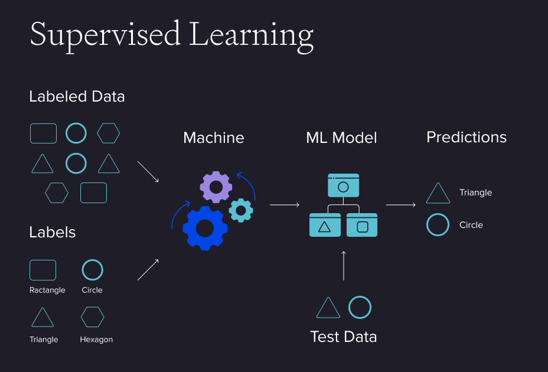
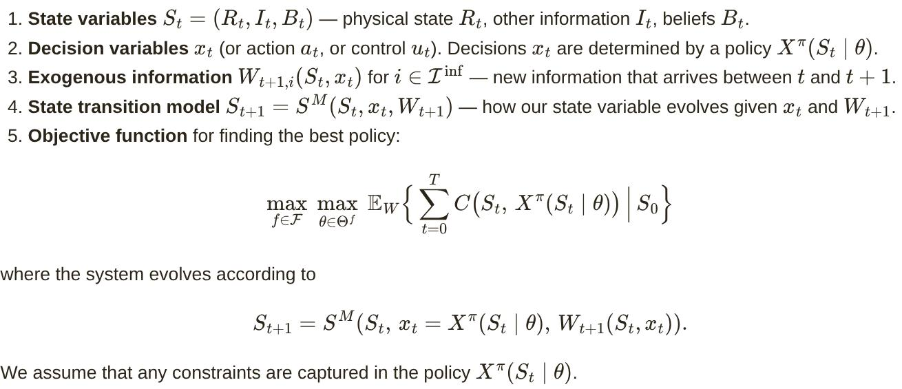
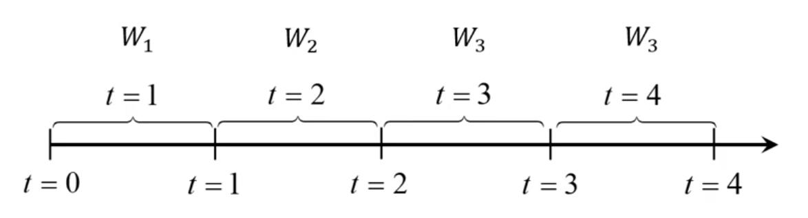
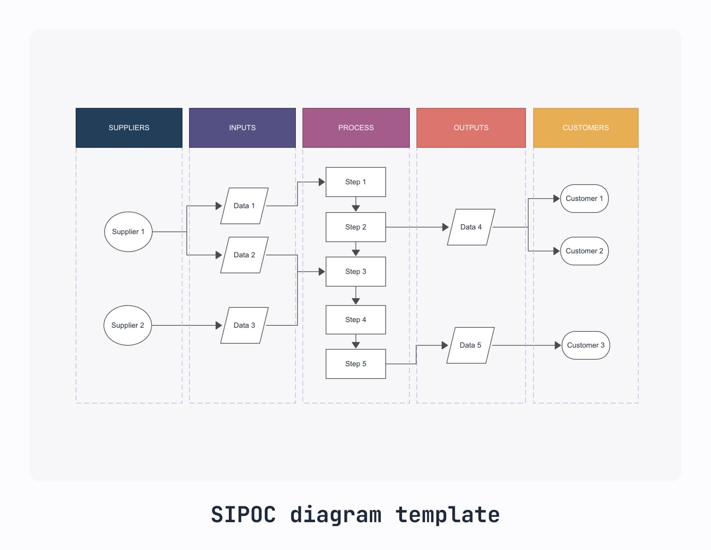
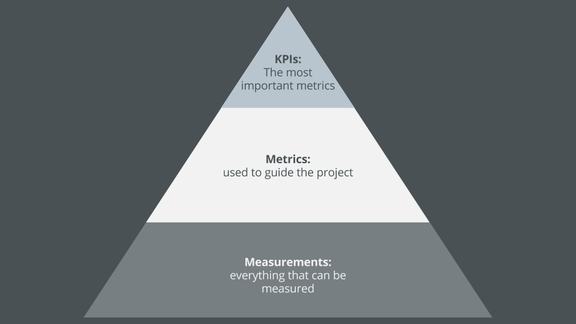
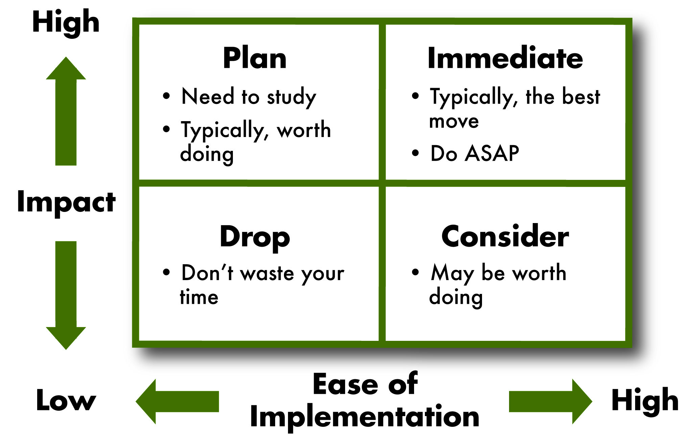
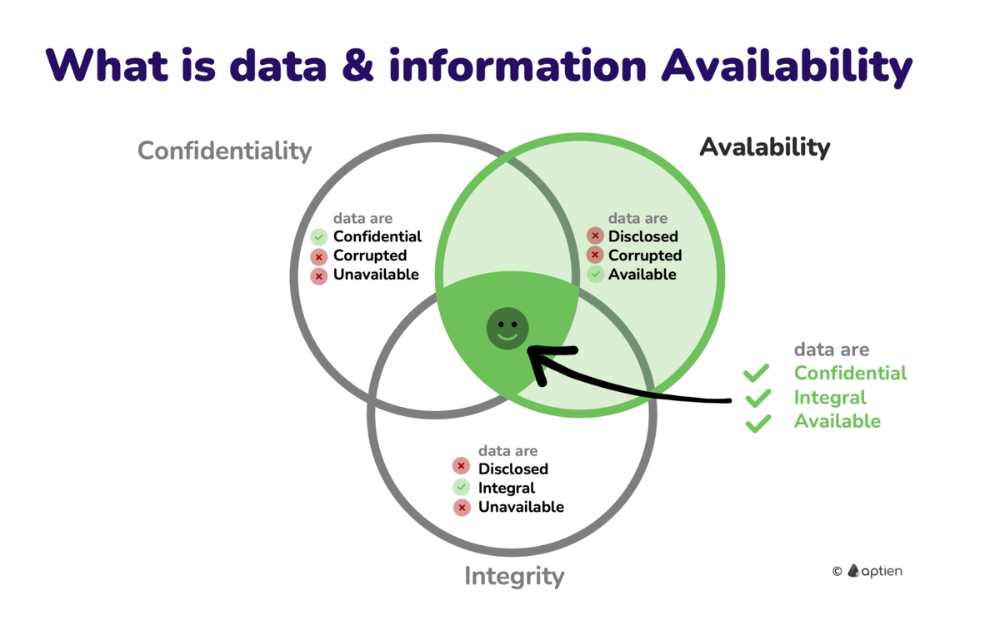

## Learning objectives

- Explain why classical modeling (linear programming, supervised ML) is insufficient for sequential decision problems.
- Define what a decision is and identify the three framing questions.
- Describe the five elements of the Universal Modeling Framework.
- Recognize the four classes of policies and give an example of each. *(pending)*

## Solving real-life problems {.smaller}

**To solve problems with computers we need to create a mathematical model**

::: {layout-align="center"}
{width="80%"}
:::

## Solving real-life problems {.smaller}

**To solve problems with computers we need to create a mathematical model**

::: {layout-align="center"}
{width="80%"}
:::

## Problem with classical modeling framework {.smaller}

Linear program / Supervised machine learning

- Assumes that all data is **known**
- Doesn't take into consideration that decisions are **repeatedly** taken **over time**
- Doesn't take into consideration the flow of **information**

## Problem with classical modeling framework {.smaller}

Linear program / Supervised machine learning

- Doesn't anticipate **external events** that can affect the performance of a decision
- Doesn't provide a way to **represent risk**
- Assumes a single decision-maker

## Types of decisions {.smaller}

A **decision** is information we control that **affects** the system.

1. Physical/financial
2. Discrete actions
3. Information acquisition/observation
4. Information communication/sharing
5. Choosing functions
6. Setting parameters
7. Estimation/identification

## Framing the problem {.smaller}

Before building a model, answer three questions:

1. What are the **performance metrics**?
   - Costs, revenues, profits, health outcomes, risk, ...

2. What **types of decisions** are being made (and who makes them)?
   - Physical/financial, discrete actions, information acquisition, ...
   - Single decision-maker or multiple agents?

3. What are the **uncertainties** that affect performance?
   - Initial beliefs (unknown parameters)
   - Exogenous information arriving over time

## Why we need prioritization {.smaller}

Even a **simple inventory problem** can be described with:

- **over 20** performance metrics
- **30** types of decisions
- **over 30** types of uncertainties

The full list is in Powell's [spreadsheet](https://tinyurl.com/PowellInventoryDecisions).

We cannot model all of this. We need to **prioritize**.

## Notations for modeling sequential decision problems {.smaller}

- **15** communities
- **8** notational styles

::: {layout-align="center"}
{width="75%"}
:::

# Universal Modeling Framework

## General View {.smaller}

- Represents **any** aspect of a controllable system.
- Takes into consideration that the **system evolves** over time with new information.

::: {layout-align="center"}
{width="75%"}
:::

More info: [video](https://www.youtube.com/watch?v=Vl5hipcYtyo), [article](https://warrenpowell.com/modeling-uncertainty/#categories)

## Using Continuous Time {.smaller}

- The information arrives continuously over time
- Functions, states, and decisions are measured at a point in time
- At time $t$ any variable indexed by:
   - $t' \leq t$ is **known**
   - $t' > t$ is **unknown**

::: {layout-align="center"}
{width="75%"}
:::

## 1. State Variables {.smaller}

$$S_{t} = (R_{t},I_{t},B_{t}) = \text{System state, where:}$$

- $R_{t} =$ **Resource/physical state** (quantities). Inventories; location/status of truck/train/plane; Energy in storage, water, money.
- $I_{t} =$ **Information state** (parameters/values, functions). Prices/weather/tariffs; Policies/forecasting methods/transition functions.
- $B_{t} =$ **Belief state** (frequentist or Bayesian). Estimates of traffic delays; Belief about the status of equipment.

## 2. Decision $x_t$ {.smaller}

**Constraints:** $x_t \in \mathcal{X}(S_t)$

We do not specify how to make a decision. Instead, we define the function (the "policy") $X^{\pi}(s)$, where $\pi = (f, \theta)$ carries information about the type of function $f$, and any tunable parameters $\theta \in \Theta^f$.

## 2. Decision $x_t$ (Types) {.smaller}

*   **Binary**: $x \in X = \{0,1\}$
*   **Finite**: $x \in X = \{1, 2, \dots, M\}$
*   **Continuous scalar**: $x \in X = [a, b]$
*   **Continuous vector**: $x = (x_1, \dots, x_k), \quad x_k \in \mathbb{R}$
*   **Discrete vector**: $x = (x_1, \dots, x_k), \quad x_k \in \mathbb{Z}$
*   **Categorical**: $x = (a_1, \dots, a_l), \quad a_i \text{ is a category (e.g. red/green/blue)}$

## 3. Exogenous Information {.smaller}

- We use `hat` to identify variables.

$$W_{t + 1} = \text{New information that first became known at time } t$$
$$= (\hat{R}_{t + 1},\hat{D}_{t + 1},\hat{p}_{t + 1},\hat{E}_{t + 1})$$

- $\hat{R}_{t + 1} =$ Equipment failures, theft, exogenous deliveries
- $\hat{D}_{t + 1} =$ New customer demands
- $\hat{p}_{t + 1} =$ Changes in prices
- $\hat{E}_{t + 1} =$ Information about the environment (temperature, ...)

**More general notation:**

$$W_{t + 1,i}(S_t,x_t) \text{ information in class } i\in \mathcal{I}^{\inf} \text{ that may depend on state } S_{t} \text{ and/or decision } x_{t}$$

## 4. Transition function {.smaller}

It's the function or group of functions that capture any of the following types of updates:

- Changes in **physical** resources such as adding inventory, moving people, or modifying equipment.
- Updates to **information** such as changes in prices and weather.
- Updates to our **beliefs** about uncertain quantities or parameters.

$$
S_{t+1} = S^M(S_t, x_t, W_{t+1})
$$

## 5. Objective functions {.smaller}

Maximizes total expected contributions over some horizon $t = 0, \ldots, T$

$$
 \max_{\pi=(f,\theta)} F^\pi(S_0) = \mathbb{E} \left\{ \sum_{t=0}^T C_t(S_t, X_t^\pi(S_t|\theta))|S_0 \right\}, \quad (1.17) 
$$

where 

$$
 S_{t+1} = S^M(S_t, X_t^\pi(S_t), W_{t+1}). \quad (1.18) 
$$

As compute all possible outcomes of $W_1, \dots, W_T$ is **not possible**.

Let $\omega$ represent a **single outcome of the sequence** $W_1(\omega), \dots, W_T(\omega)$ and we can have $N$ possible outcomes of each sequence $\omega^n$

$$
\omega^n = (W_1^n, \dots, W_t^n, \dots, W_T^n)
$$

$$
\max_{\pi=(f,\theta)} \bar{F}^\pi(S_0) = \frac{1}{N} \sum_{n=1}^N \sum_{t=0}^T C_t(S_t(\omega^n), X^\pi_t(S_t(\omega^n)))
$$

Where:

$$
S_{t+1}(\omega) = S^M(S_t(\omega), X^\pi_t(S_t(\omega)), W_{t+1}(\omega))
$$

# Modeling process

## Process Overview {.smaller}

```{mermaid}
%%| fig-width: 10
flowchart LR
  A[Ambiguous Problem] --> B("Precise Definition <br> (Broken Down into Pieces)")
  B --> C[Computer Software]

  classDef nodeStyle fill:#1e293b,stroke:#38bdf8,stroke-width:2px,color:#f8fafc;
  classDef highlight fill:#0f172a,stroke:#60a5fa,stroke-width:2.5px,color:#ffffff;
  
  class A,C nodeStyle;
  class B highlight;
```

::: {layout-align="center"}
{width="40%"}
:::

## The Narrative (step 1) {.smaller}

```{mermaid}
%%| fig-width: 10
flowchart TD
    A["⚠️ Problem Definition<br/>Describe the problem in plain English"]
    B["📉 Consequences of Inaction<br/>What happens if the problem remains unsolved?"]
    D["🔍 Project Scope<br/>What will the solution address, and what is explicitly excluded?"]
    E["💡 Solution Overview<br/>Describe the solution to be developed and its main deliverables"]

    A --> B --> D --> E

    classDef danger fill:#2c0f14,stroke:#f87171,stroke-width:2px,color:#fef2f2,width:260px,white-space:normal,text-align:center;
    classDef warning fill:#2a1b0c,stroke:#fbbf24,stroke-width:2px,color:#fffbeb,width:260px,white-space:normal,text-align:center;
    classDef info fill:#0c2136,stroke:#38bdf8,stroke-width:2px,color:#f0f9ff,width:260px,white-space:normal,text-align:center;
    classDef success fill:#062319,stroke:#34d399,stroke-width:2px,color:#ecfdf5,width:260px,white-space:normal,text-align:center;

    class A danger;
    class B warning;
    class D info;
    class E success;
```

# Framing the Problem

## Roadmap: Four Questions, Four Tools {.smaller}

| Question | Step | Tool that answers it |
|:--|:-:|:--|
| Who decides, and where are the boundaries? | Scope | Context questions, SIPOC |
| What do we want to achieve? | 2A | KPI list → **Metrics pyramid** |
| What can we control? | 2B | Process maps → **Decision impact matrix** |
| What can we *not* control? | 2C | Uncertainty inventory → **Uncertainty impact matrix** |
| Do we have the evidence to model it? | Check | Relationship matrix |

: Each step produces the input for the next one {.striped}

## Where do we start? Scope {.smaller}

**Question:** Who is deciding, and what is inside the problem?

* **Who** makes the decision, in what **setting**, with what **history**, and to achieve what?
* Define what enters the system, what leaves it, and who receives it.

::: {.callout-tip}
### Tool: SIPOC (Supplier, Input, Process, Output, Customer)
Best for **defining system boundaries** and external interfaces *before* choosing metrics.
:::



## What do we want to achieve? (step 2A) {.smaller}

**Question:** Which metrics define a "good" outcome?

1. **Identify relevant KPIs:** costs, delivery times, customer satisfaction, emissions.
2. **Define units, baselines and targets** for each one.
3. **Classify each metric:**
    * **Objective:** optimize it (minimize cost, maximize profit).
    * **Target:** a numerical threshold to hit.
    * **Constraint:** a non-negotiable limit (legal, budget, capacity).

## From a List of KPIs to a Priority (step 2A) {.smaller}

**Question:** Which metrics matter most?

* Rank metrics in tiers; the **top metric must be an objective**.
* Tag each as *Max, Min, Target, Floor* or *Ceiling*.

::: {.callout-tip}
### Tool: Metrics pyramid
Tier 1 (one metric) → Tier 4. Forces a single top priority and exposes conflicts between metrics.
:::

**Output:** prioritized metrics with units, baselines and targets.



## What can we control? (step 2B) {.smaller}

**Question:** Who decides what, when, and with what information?

* **Decision-makers:** single manager, multiple agents, algorithms.
* **Alternatives & constraints** at each decision point.
* **Timing & frequency:** what information is available at that exact moment?

| If you need to know... | Use |
|:--|:--|
| Who hands off to whom, and who owns each decision | **Cross-functional flowchart** |
| The order of steps, operations and inspection points | **Operations process chart** |
| How things physically move, and over what distances | **Flow / string diagram** |

Pick the tool by the question, not by habit; one problem may need only one of them.

## Which Decisions Really Matter? (step 2B) {.smaller}

**Question:** Which decisions have the most impact on my top metrics?

1. **List decisions**, from general ("assign drivers to loads") to specific ("assign driver X to load Y").
2. **Check the 10 decision types** to avoid blind spots (physical/financial, information acquisition, parameter setting, ...).
3. **Score impact** on each tiered metric: **H → M → L → N**.
4. **Rank** rows by impact on the highest-tier metrics.

::: {.callout-tip}
### Tool: Decision impact matrix
Decisions × Metrics. Sub-decisions can be nested as the analysis gets deeper.
:::



## What can we *not* control? (step 2C) {.smaller}

**Question:** What could make performance differ from what we expect?

1. **Identify** uncertain inputs and events: demand shifts, delays, equipment failures.
2. **Characterize** each one:
    * **Variability & frequency:** how often?
    * **Magnitude & dependencies:** how large, and correlated with what?
    * **Extreme events:** severe weather, port closures.
3. **Check the 12 categories of uncertainty** (observational, exogenous, model, implementation, ...) to avoid blind spots.

## Exogenous Information: Types {.smaller}

- **1. Observational Uncertainty:** GPS errors, inaccurate warehouse counts, hidden reefer container conditions.
- **2. Exogenous Uncertainty:** Random customer order volumes/times, truck breakdowns, storm delays.
- **3. Prognostic Uncertainty:** Errors in holiday demand forecasts, vessel arrivals, or fuel prices.
- **4. Inferential Uncertainty:** Estimating price-demand elasticity or component remaining life.
- **5. Experimental Variability:** Noise in test results (route design, warehouse layout simulation).
- **6. Model Uncertainty:** Not knowing how customers or market competitors react to changes.

## Exogenous Information: Types {.smaller}

- **7. Transitional Uncertainty:** Inventory shrinkage, random dock loading times, traffic fluctuations.
- **8. Implementation Errors:** Drivers ignoring routes, pickers pulling wrong items, equipment failures.
- **9. Communication Errors:** Misheard verbal instructions, language barriers, missed schedule updates.
- **10. Algorithmic Instability:** Vehicle routing solvers or ML models yielding different outputs on same data.
- **11. Goal Uncertainty:** Disagreements between finance, sales, and sustainability departments.
- **12. Environmental Uncertainty:** New tariffs, economic shifts, or changing emissions regulations.

## Which Uncertainties Really Matter? (step 2C) {.smaller}

**Question:** Which uncertainties affect my metrics the most?

* Score each uncertainty against the same tiered metrics (**H / M / L / N**).
* Keep a **structured inventory** of the quantified risks.

::: {.callout-tip}
### Tool: Uncertainty impact matrix
Uncertainties × Metrics. Uncertainties are not nested: they live at the top level of the frame.
:::


## Do We Have the Evidence? Data Validation {.smaller}

**Question:** Can we connect data to each element of the model?

* **Validate** availability, quality, granularity and accuracy for metrics, decisions and uncertainties.
* **Combine** the two impact matrices into a single view:

$$\text{Metrics} \times \text{Decisions} \times \text{Uncertainties}$$

* **Document** data gaps and missing variables, and write testable hypotheses.



# Pizza Resturant (Inventary Problem)

## 1. Narrative {.smaller}

- How many **pounds of sausage** to order from its food distributor?
- The decision **is taken** at the end of each day (time $t$) where
   - Sausage's cost is **known**
   - Pizza's price is **known**
   - Demand is **unknown**
- If there is sausage left over, it can be held to the following day
- The order **arrives** the following morning

## 2. Core elements of the problem {.smaller}

- **Metrics**

$$
\max \text{profit} = \text{Sales of Sausage} - \text{Cost of Purchasing}
$$

- **Decisions**

   - How much to order at the end of one day?

- **Sources of uncertainty**

    - The demand for sausage the next day.

## 3. Universal Modeling Framework {.smaller}

**1. State Variables:** $S_0 = (R_0^{inv}, (p, c), (\bar{D}, \bar{\sigma}^D))$

**2. Decision $x_t$:** $x_t = X^\pi(S_t)$

**3. Exogenous Information:** $W_{t+1} = \hat{D}_{t+1}$

**4. Transition function:** $R_{t+1}^{inv} = \max\{0, R_{t}^{inv} + x_t - \hat{D}_{t+1} \}$

**5. Objective functions:**

$$
C(S_t, x_t, \hat{D}_{t+1}) = -cx_t + p \min \{ R_{t}^{inv} +  x_t,  \hat{D}_{t+1}\}
$$
$$
F^\pi (S_0) = \mathbb{E} \left\{ \sum_{t=0}^T C(S_t, X^\pi (S_t), \hat{D}_{t+1} ) | S_0 \right\}
$$

## 4. Uncertainty model {.smaller}

1. **Historical data** if we were able to capture this **lost demand**.

2. **Build a mathematical** model to create sets of demands ($\hat{D}_1^n, \dots, \hat{D}_T^n$) that we can repeat $N$ times.

$$
\hat{D}_{t+1} \sim N(\bar{D}, (\bar{\sigma}^D)^2)
$$

## 5. Designing policies {.smaller}

$$
X^\pi(S_t|\theta) = \begin{cases} \theta^{\text{max}} - R_t & \text{if } R_t < \theta^{\text{min}}, \\ 0 & \text{otherwise}, \end{cases}
$$

## 6. Evaluating policies {.smaller}

1. Generate $K$ possible values $\theta_1, \dots, \theta_K$
2. Simulate each one to find $\bar{F}^\pi(\theta_k|S_0)$ for each $k$
3. Pick the value of $\theta_k$ that works the best.

$$
\overline{F}^{\pi}(\theta |S_{0}) = \frac{1}{N}\sum_{n = 1}^{N}\sum_{t = 0}^{T}C(S_{t},X^{\pi}(S_{t}|\theta),\hat{D}_{t + 1}^{n}).
$$
