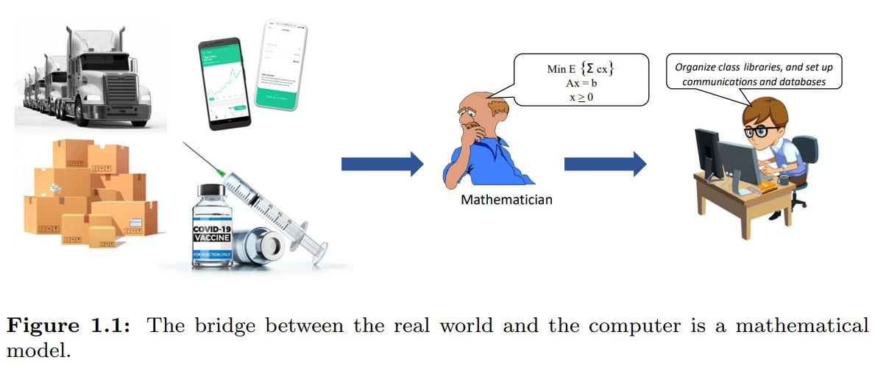
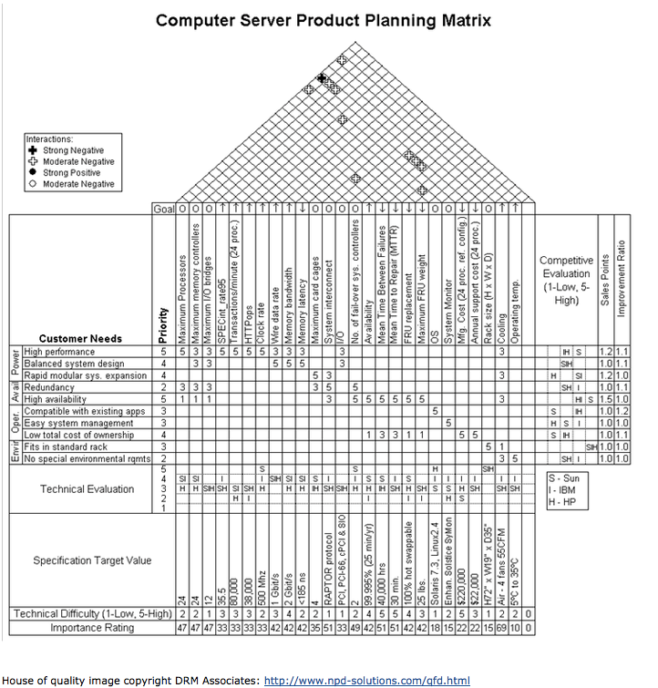
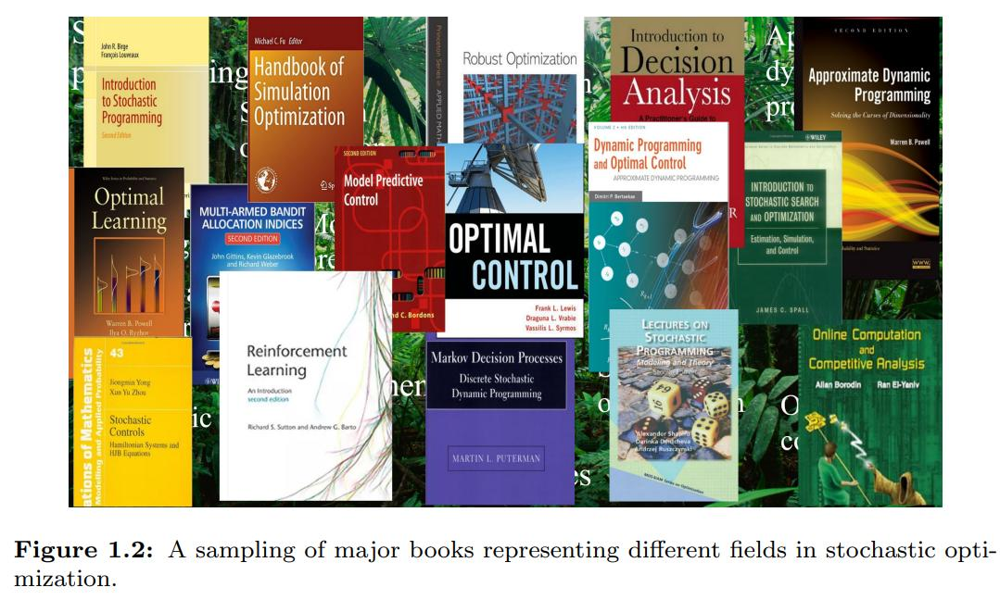
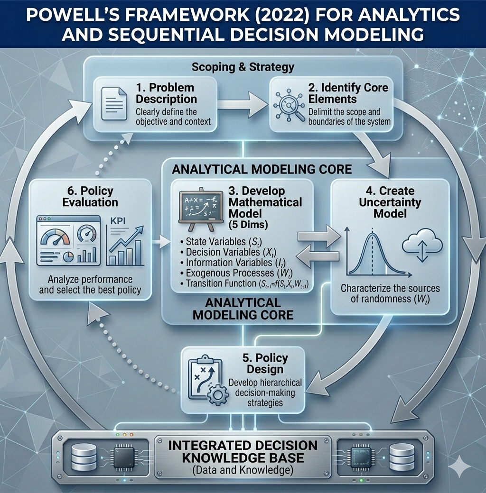

## Learning objectives

- Explain why classical modeling (linear programming, supervised ML) is insufficient for sequential decision problems.
- Define what a decision is and identify the three framing questions.
- Describe the five elements of the Universal Modeling Framework.
- Recognize the four classes of policies and give an example of each. *(pending)*

## Solving real-life problems {.small}

**To solve problems with computers we need to create a mathematical model**



## Solving real-life problems {.small}

**To solve problems with computers we need to create a mathematical model**


## Problem with classical modeling framework {.small}

Linear program / Supervised machine learning

- Assumes that all data is **known**
- Doesn't take into consideration that decisions are **repeatedly** taken **over time**
- Doesn't take into consideration the flow of **information**

## Problem with classical modeling framework {.small}

Linear program / Supervised machine learning

- Doesn't anticipate **external events** that can affect the performance of a decision
- Doesn't provide a way to **represent risk**
- Assumes a single decision-maker

## Types of decisions {.small}

A **decision** is information we control that **affects** the system.

1. Physical/financial
2. Discrete actions
3. Information acquisition/observation
4. Information communication/sharing
5. Choosing functions
6. Setting parameters
7. Estimation/identification

## Framing the problem {.small}

Before building a model, answer three questions:

1. What are the **performance metrics**?
   - Costs, revenues, profits, health outcomes, risk, ...

2. What **types of decisions** are being made (and who makes them)?
   - Physical/financial, discrete actions, information acquisition, ...
   - Single decision-maker or multiple agents?

3. What are the **uncertainties** that affect performance?
   - Initial beliefs (unknown parameters)
   - Exogenous information arriving over time

## Why we need prioritization {.small}

Even a **simple inventory problem** can be described with:

- **over 20** performance metrics
- **30** types of decisions
- **over 30** types of uncertainties

The full list is in Powell's [spreadsheet](https://tinyurl.com/PowellInventoryDecisions).

We cannot model all of this. We need to **prioritize**.


## Interaction matrix {.small}

How to prioritize: build a matrix of **metrics × decisions × uncertainties**.



[ASQ source](https://asq.org/quality-resources/house-of-quality)

*Analogy from quality engineering: the House of Quality.*

## Notations for modeling sequential decision problems {.small}

- **15** communities
- **8** notational styles

<br>



## Universal Modeling Framework {.small}

- Represents **any** aspect of a controllable system.
- Takes into consideration that the **system evolves** over time with new information.


## Modeling process

```{mermaid}
flowchart LR
  A[Ambiguous Problem] --> B("Precise Definition <br> (Broken Down into Pieces)")
  B --> C[Computer Software]
```

